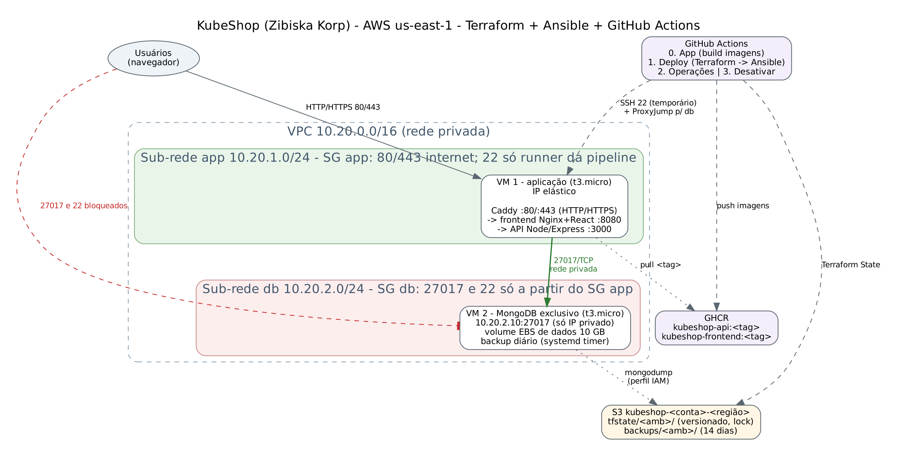

# PM-04 · KubeShop na nuvem com Terraform, Ansible e CI/CD

Projeto final de DevOps e Infraestrutura (UniAmérica). A demanda escolhida é o **KubeShop**
da Zibiska Korp: publicar a loja na nuvem com a aplicação e o MongoDB em VMs separadas,
o banco isolado na rede privada e todo o ciclo de vida operado por pipelines.

| Integrante | Papel no projeto |
|---|---|
| Luis Felipe Coradi e Sousa | |
| Rubens Prado | |
| Guilherme Royer | |

- Demanda: [escopo do KubeShop](https://github.com/LaercioMLB/kube-shop-v2/blob/main/escopo.pdf) · código da aplicação: [LaercioMLB/kube-shop-v2](https://github.com/LaercioMLB/kube-shop-v2) (não foi alterado)
- Arquitetura, decisões e limitações: [docs/arquitetura.md](docs/arquitetura.md)
- Estimativa de custos: [docs/custos.md](docs/custos.md)
- Manual de operação (inclui o Terraform State): [docs/operacao.md](docs/operacao.md)
- Acesso administrativo (separado do acesso da aplicação): [docs/acesso-administrativo.md](docs/acesso-administrativo.md)
- Integração com o CI/CD da aplicação: [docs/integracao-cicd.md](docs/integracao-cicd.md)
- Inventário dos recursos: [docs/inventario.md](docs/inventario.md)
- Roteiro da apresentação (3 cenários + validação da demanda): [docs/roteiro-apresentacao.md](docs/roteiro-apresentacao.md)
- Relatório de validação e evidências: [evidencias/](evidencias/README.md)



## Visão geral

| Camada | Ferramenta | O que faz |
|---|---|---|
| Pipeline | GitHub Actions | 5 workflows com execução manual e parâmetros; Terraform e Ansible em sequência; logs e parada em caso de erro |
| Provisionamento | Terraform (AWS) | VPC, 2 sub-redes, security groups, 2 VMs Ubuntu 24.04, IP elástico, volume EBS de dados, perfis IAM; state no S3 com trava |
| Configuração | Ansible | atualizações do SO, pacotes, swap, Docker, contêineres, volume de dados, backup diário, verificação |
| Aplicação | imagens Docker | API e frontend do KubeShop publicados no GHCR; `mongo:8.0.17`; `caddy:2.11.9-alpine` |

```
.github/workflows/
  app-images.yml   0. App: testes + build + push das imagens (CI/CD da aplicação)
  deploy.yml       1. Deploy: Terraform (plan/apply) -> Ansible -> teste externo
  operations.yml   2. Operações: status, logs, restart, smoke, isolation-check, backup, restore-*
  destroy.yml      3. Desativar: backup final -> terraform destroy -> o que sobra e custa
  ci.yml           validação a cada push (fmt/validate, ansible-lint, actionlint, shellcheck)
terraform/         main.tf variables.tf outputs.tf providers.tf backend.tf
ansible/           playbook.yml, ops-*.yml, group_vars/, roles/{os_updates,packages,docker,
                   data_volume,containers,backup,verify}
scripts/           bootstrap do bucket, init, SSH temporário, inventário, teste externo
docs/  evidencias/
```

## Parâmetros do deploy

| Parâmetro | Exemplo | Efeito |
|---|---|---|
| `environment` | dev / homolog / prod | ambiente de destino; cada um tem seu próprio state e seus recursos |
| `instance_name` | vm-pm04 | nome das VMs (`vm-pm04-dev-app`, `vm-pm04-dev-db`); muda só a tag, sem recriar |
| `instance_type` | t3.micro / t3.small | tamanho da VM da aplicação; muda com stop/start, sem recriar |
| `db_instance_type` | t3.micro / t3.small | tamanho da VM do banco; os dados ficam no volume EBS |
| `docker_image` | vazio | prefixo das imagens; vazio = `ghcr.io/<dono-do-repo>/kubeshop` (`-api`, `-frontend`) |
| `docker_tag` | 1.0.0 | versão implantada; troca controlada com rollback automático |
| `update_os` | true / false | aplica as atualizações do Ubuntu (reinicia uma VM por vez se preciso) |
| `extra_packages` | htop,git | pacotes adicionais instalados nas VMs |
| `plan_only` | true / false | só mostra o `terraform plan`, sem aplicar nada |

## Configuração (uma vez)

1. **Conta AWS** e um usuário IAM para a pipeline (ex.: `github-pm04`) com as políticas
   `AmazonEC2FullAccess`, `AmazonS3FullAccess` e `IAMFullAccess`. Crie uma chave de acesso.
   Recomendado: alerta de gasto em *Billing > Budgets* (ex.: US$ 20).
2. **Secrets do repositório** (*Settings > Secrets and variables > Actions*):

   | Secret | Conteúdo |
   |---|---|
   | `AWS_ACCESS_KEY_ID` / `AWS_SECRET_ACCESS_KEY` | chave do usuário IAM da pipeline |
   | `SSH_PRIVATE_KEY` | chave privada de administração das VMs (a pública é derivada dela) |
   | `MONGO_ROOT_PASSWORD` / `MONGO_APP_PASSWORD` | senhas do MongoDB (definidas na criação do banco) |
   | `GHCR_TOKEN` (opcional) | token `read:packages`, só se o pull das imagens com o token padrão falhar |

   Atalho: `bash scripts/gerar-segredos.sh` (Linux, macOS ou Git Bash no Windows) cria a
   chave SSH e as senhas e grava os secrets direto no GitHub (precisa do `gh` autenticado).
   Depois faltam só os dois da AWS. Também dá para criar tudo pela interface do GitHub:
   chave com `ssh-keygen -t ed25519 -N "" -f kubeshop-pm04` e senhas aleatórias longas.
3. **Variáveis opcionais** (*Variables*): `AWS_REGION` (padrão `us-east-1`), `DOMAIN_NAME`
   (ex.: `loja.trabaidafacul.site`, ativa HTTPS automático), `ACME_EMAIL`,
   `ADMIN_CIDRS` (ex.: `["200.1.2.3/32"]` para SSH fixo de um administrador).

O bucket do state e dos backups (`kubeshop-<conta>-<região>`) é criado pela própria
pipeline na primeira execução.

## Uso

1. **0. App** com `version=1.0.0` → publica as imagens.
2. **1. Deploy** com os parâmetros desejados → cria/atualiza o ambiente e imprime o endereço da loja.
3. **2. Operações** para saúde, logs, reinício, backup e restauração.
4. **3. Desativar** (`DESTRUIR <ambiente>`) ao final, para parar a cobrança.

Detalhes, resultados esperados e o que fazer em caso de falha: [docs/operacao.md](docs/operacao.md).
