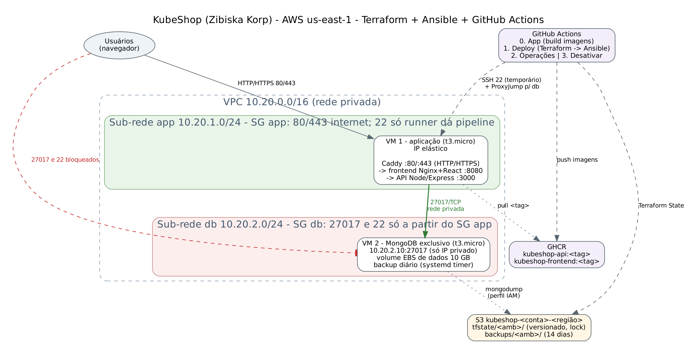

# Arquitetura e decisões técnicas

## Análise da demanda

O KubeShop tem três componentes, validados pela Zibiska Korp com Docker Compose:

| Componente | Imagem | Porta | Depende de |
|---|---|---|---|
| Frontend React servido por Nginx | `apps/frontend/Dockerfile` | 8080 | API (Nginx encaminha `/api` para `api:3000`) |
| API Node.js/Express | `apps/backend/Dockerfile` | 3000 | MongoDB (`MONGO_HOST`, usuário e senha por arquivo) |
| MongoDB autenticado | `mongo:8.0.17` | 27017 | volume persistente; `init.js` cria o usuário da aplicação |

Pontos que mudam ao sair do Compose para dois servidores (escopo, item 5):

- **Endereço do banco:** no Compose a API usa o nome `mongodb`; aqui usa o IP privado fixo `10.20.2.10`.
- **Credenciais:** saem dos arquivos `.secrets/` locais e passam a vir dos GitHub Secrets. O Ansible grava os arquivos nas VMs com dono e permissão mínimos (`0400`).
- **Ordem de inicialização:** o `depends_on` do Compose não funciona entre hosts. A pipeline sobe o banco primeiro e espera o healthcheck; a API só é dada como pronta quando `/api/health/ready` confirma o banco.
- **Entrada pública:** o Compose publicava o frontend na 8080. Aqui o Caddy recebe 80/443 e encaminha para o frontend, com HTTPS automático quando há domínio.

O código da aplicação não foi alterado. A adaptação ficou toda na configuração da implantação.

## Requisitos do escopo e como foram atendidos

| Requisito | Solução |
|---|---|
| REQ-01 Servidores | 2 VMs EC2 Ubuntu 24.04: `*-app` (Caddy, frontend, API) e `*-db` (só MongoDB) |
| REQ-02 Banco isolado | MongoDB só na VM do banco, publicado apenas em `10.20.2.10:27017`; o SG `db` não tem nenhuma regra de entrada vinda da internet |
| REQ-03 Rede privada | SG `db` libera 27017 só para o SG `app` (referência entre security groups, não por IP). Teste automatizado: rotina `isolation-check`. Procedimento administrativo separado: [acesso-administrativo.md](acesso-administrativo.md) |
| REQ-04 Acessos | SSH da VM app fechado por padrão; a pipeline libera só o IP do runner durante a execução e remove no final. VM db só aceita SSH vindo da VM app (ProxyJump). Senhas, chaves e tokens só em GitHub Secrets; tarefas com segredos usam `no_log` |
| REQ-05 Persistência | Dados em volume EBS próprio (`/srv/kubeshop-data`), independente do disco do sistema; Docker só sobe depois do volume montado. Alteração de infraestrutura que preserva dados: troca de `db_instance_type` |
| Item 8 IaC e state | Todo o ambiente em Terraform; state no S3 versionado, criptografado, com trava nativa (`use_lockfile`) e uma chave por ambiente; recuperação em [operacao.md](operacao.md#terraform-state-armazenamento-proteção-e-recuperação) |
| Item 9 Operações | Validar/planejar (`plan_only`, CI), provisionar/configurar e atualizar (Deploy), manter/diagnosticar (Operações), backup/restauração (timer diário + rotinas), desativar (Destroy) |
| Item 10 Operação pelo cliente | [operacao.md](operacao.md); ações destrutivas separadas e com confirmação digitada |
| Item 7 CI/CD da aplicação | workflow `0. App` + contrato de integração em [integracao-cicd.md](integracao-cicd.md) |
| Item 12 Custos | [custos.md](custos.md) |
| Etapa 8 Inventário | [inventario.md](inventario.md) |

## Decisões

**Provedor: AWS (us-east-1).** A equipe já usou AWS nos trabalhos anteriores. O plano gratuito
para contas novas cobre o período do projeto. us-east-1 é a região mais barata para EC2; a
latência maior para o Brasil não pesa numa loja de demonstração. Em produção real, sa-east-1
(São Paulo) daria menos latência por ~60% a mais no preço da VM.

**Duas t3.micro.** O KubeShop é leve: a API usa poucos MB, o MongoDB foi limitado a 256 MB de
cache (`--wiredTigerCacheSizeGB 0.25`, como no Compose) e cada VM tem 1 GB de swap para picos.
Créditos de CPU em modo `standard` para não haver cobrança extra por uso de CPU acima da linha
de base. Se precisar de mais folga, o parâmetro `instance_type` sobe para t3.small sem recriar.

**Sem NAT Gateway.** A forma "de livro" seria o banco numa sub-rede sem rota para a internet,
saindo por um NAT Gateway (~US$ 33/mês, mais que todo o resto somado). A VM do banco tem IP
público só para saída (atualizações e envio dos backups) e **nenhuma porta de entrada
pública**: o isolamento é feito pelo security group e comprovado pela rotina
`isolation-check`. Limitação documentada.

**Volume EBS separado para os dados.** Os dados não dependem do disco do sistema. Trocar o
tipo da VM, reiniciar ou até recriar a VM do banco não apaga os pedidos.

**Sem recriações desnecessárias.** A AMI é resolvida na criação e ignorada depois
(`ignore_changes = [ami]`): uma AMI nova da Canonical não recria as VMs. As atualizações do
SO vêm pelo Ansible (`update_os`). Nomes técnicos (security groups, IAM, key pair) não dependem
de `instance_name`: renomear só altera a tag.

**Caddy na frente.** HTTP pelo IP elástico sem configuração extra e HTTPS automático (Let's
Encrypt) quando `DOMAIN_NAME` está definido. O domínio do grupo (`trabaidafacul.site`, na
Cloudflare) pode ser usado com um registro A **sem proxy** (nuvem cinza) apontando para o IP
elástico.

**SSH temporário em vez de porta aberta.** Os runners do GitHub mudam de IP a cada execução.
Em vez de deixar a 22 aberta para a internet, a pipeline cria uma regra para o IP do runner
(descrição `github-actions-<run>`) e remove no final, mesmo se a execução falhar. A regra fica
fora do Terraform (regras em recursos separados), então não gera diferença no `plan`. O
Session Manager da AWS fica disponível como acesso de emergência pelo console, sem porta.

**Atualização controlada das imagens.** O Ansible baixa as imagens novas antes de mexer em
qualquer contêiner, troca a API, espera ficar saudável, troca o frontend. Se a versão nova não
ficar saudável, volta para a anterior e a pipeline falha com a mensagem do motivo. Tags fixas
(`1.0.0`, `1.1.0`) são o padrão; tags mutáveis (`latest`, `stable`) forçam o download a cada
execução.

**Backups lógicos no S3.** `mongodump` diário às 03:00 (systemd timer), enviado ao S3 com o
perfil IAM da VM (nenhuma chave da AWS no servidor), retenção de 14 dias. A restauração é
testada em um contêiner MongoDB temporário **sem rede**, sem tocar no banco em uso.

**CI/CD da aplicação.** O escopo considera que a Zibiska Korp já tem CI/CD. O workflow
`0. App` representa esse fluxo: roda os testes do KubeShop, constrói as imagens e publica no
GHCR com a tag de versão. O ponto de integração é o registry: a infraestrutura implanta a tag
informada em `docker_tag`.

## Limitações

- Uma zona de disponibilidade e uma VM por camada: sem alta disponibilidade. Reinício ou troca de tipo causa indisponibilidade de alguns minutos.
- Sem NAT Gateway (ver acima).
- As senhas do MongoDB valem desde a criação do banco. Trocar o secret depois exige rotação manual no banco.
- O restore `replace` substitui o banco `kubeshop` inteiro pelo conteúdo do backup (com backup de segurança antes).
- HTTPS depende do registro DNS apontar para o IP elástico antes do deploy com `DOMAIN_NAME`.
